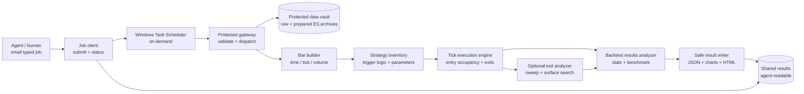

# Guarded Research Runtime — architecture draft

**Status: proposed design only, October 1, 2026.** This document does not
create Windows accounts, move market data, change the current backtester, or
alter live trading. Its purpose is to define the boundary before implementation.

The [research validation and provenance requirements](research_validation_and_provenance_requirements.md)
extend this draft with required audit jobs, exact source filenames, contract
identity, revised dataset naming, and backtest output identity.

The [interface and trade-viewer specification](research_interfaces_and_trade_viewer.md)
defines the handoffs, canonical job names, and bounded candlestick/line views.

The [implementation phases](guarded_research_implementation_phases.md) define
deliverables, dependencies and completion checks against all related contracts.

## 1. Objective

GNET already has Python components that can build bars from ES ticks, generate
strategy candidates, replay exits, search an exit-policy surface, and produce
backtest statistics. The new architecture keeps those capabilities while
changing how they are invoked:

- the coding agent develops code and submits small, typed research jobs;
- protected runtime processes read the large raw datasets and perform heavy
  computation;
- the agent receives compact inventories, metrics, manifests, charts and HTML
  reports, rather than raw tick, bar, trade, or Parquet files.

This reduces accidental large-data tokenization and makes research runs
reproducible. It is an operational safety boundary, not a claim that it makes
results statistically valid or prevents an Administrator from changing NTFS
permissions.

## 2. Three locations and identities

```text
Development identity: g_med / Codex
  C:\Users\g_med\python_new\GNET
  - source code, tests, job client, experiment specifications
  - cannot read the raw-data vault

Broker identity: GNETDataBroker (standard local Windows account)
  C:\GNET_DataVault\raw
  C:\ProgramData\GNETBroker\runtime
  - raw exports, prepared tick archives, manifests
  - approved, versioned runtime releases only

Shared exchange: g_med + broker
  C:\GNET_Exchange\requests
  C:\GNET_Exchange\status
  C:\GNET_Results
  - typed requests, state, summaries, charts, HTML reports
  - never raw tick/bar/trade exports
```

The **vault** contains data only. The protected **runtime** contains deployed
code. They must not be the same folder.

`GNETDataBroker` owns the vault and has read access to the protected runtime.
The normal development identity can write source code in the repository but
cannot modify the deployed runtime copy or read the vault. A later optional
`GNETResearchRunner` account may run CPU-heavy backtests with read-only vault
access; this is not required for the first implementation.

## 3. On-demand execution, not polling

Windows Task Scheduler launches named jobs as the broker account. It is an OS
launcher; it is **not** the broker gateway. The broker gateway is the Python
program launched by the task.

```text
Agent job client
  -> writes request_<job-id>.json to C:\GNET_Exchange\requests\pending
  -> invokes the named task on demand
  -> reads status/result_<job-id>.json and safe report artifacts

Windows Task Scheduler
  -> starts protected Python gateway as GNETDataBroker

Protected gateway
  -> validates request against a fixed allowlist
  -> reads vault and runs the selected release
  -> writes bounded output to C:\GNET_Results\<job-id>\
```

The client launches the task with:

```powershell
schtasks /run /tn "\GNET\DataReport"
```

`schtasks` is Windows' built-in Scheduled Tasks command. `/run` means start
now; `/tn` means task name. It is not a repeating schedule. The registered
task already stores the executable path and the `GNETDataBroker` run-as
identity. The gateway processes one queued job (or a bounded batch) and exits.
It uses file locking plus a job ID so two task invocations do not process the
same request.

Large backtests should use a separate named task such as
`\GNET\ResearchRun`. The agent submits a job then polls its small status file;
it does not keep a terminal process or raw data open.

## 4. Agent-facing job contract

The agent interacts only through a small client such as:

```powershell
python -m gnet_jobs submit --request config/jobs/es_exit_sweep.json
python -m gnet_jobs status --job-id 20261001T103000Z-a41f
python -m gnet_jobs report --job-id 20261001T103000Z-a41f
```

The client may create a request and start a named task automatically. No
per-job human approval is needed once the gateway is correctly protected.
The gateway, not the client, enforces every safety rule.

Every request must include:

- a generated `job_id`;
- one approved `operation`;
- a registered `dataset_id`, never an arbitrary raw path;
- bounded dates, resource budget, and declared output level;
- an immutable runtime release ID and source/config hash;
- a unique result location controlled by the gateway.

The gateway rejects arbitrary Python, shell commands, file paths, `raw_rows`,
unbounded samples, and any output mode that can copy raw data to the shared
area. It also rejects an unknown strategy or unsupported parameter type.

Example: a descriptive data request.

```json
{
  "operation": "data_inventory",
  "dataset_id": "es_spliced_20260921",
  "asset": "ES",
  "output_level": "summary",
  "max_rows_returned": 0
}
```

Example: a complete backtest request.

```json
{
  "operation": "backtest_sweep",
  "dataset_id": "es_spliced_20260921",
  "sessions": {"start": "2026-03-16", "end": "2026-08-14"},
  "bars": [{"kind": "time", "size": 30}],
  "strategy": {"name": "ma_cross", "parameters": {"fast": 9, "slow": 18}},
  "exit_search": {
    "profit_ticks": [2, 4, 6, 8],
    "stop_ticks": [2, 4, 6, 8],
    "hold_seconds": [30, 60, 120, 300],
    "max_evaluations": 96,
    "max_seconds": 3600,
    "workers": 4
  },
  "costs": {"round_trip_cost": 6.48},
  "output_level": "reports_and_metrics"
}
```

The schema will be versioned. The final service must validate it before any
vault file is opened.

## 5. Runtime modules and their boundaries



### A. Data catalog and vault adapter

Owns immutable raw deliveries, prepared archives, merged/spliced dataset
versions, manifests, coverage, and provenance. It exposes only metadata and
registered dataset IDs to callers. Existing sources include
`config/backtester.data_sources.json`, the inventory command, preparation,
splice, and adjusted-merge modules.

**Inputs:** a broker-side ingestion request or approved raw delivery.

**Safe outputs:** dataset ID, asset, contract/vintage, date coverage, session
count, row count, schema version, source hash, completeness status.

### B. Bar builder

Consumes a registered tick archive and produces requested engineered bars.
It supports the current time, tick-count, and traded-volume bar families.
Only requested bar types and sizes are built. Bars stay in the protected job
workspace unless a bounded visual or aggregate is requested.

**Inputs:** dataset ID, sessions, `[{kind, size}]`, session policy.

**Outputs:** bar counts, coverage, bar-schema metadata, charts/small previews
when allowed, and a protected internal artifact reference.

### C. Strategy inventory and candidate generator

Owns primary-strategy trigger logic and strategy-specific parameter validation.
The current inventory contains `ma_cross`; future strategies are registered
plugins rather than engine-level parameters. It turns bars into candidate
entries. Candidate output remains distinct from an executable trade.

**Inputs:** protected bars; registered strategy name and parameters.

**Outputs:** candidate count, session/month distribution, skip reasons, and a
protected candidate artifact. Full candidate rows are not copied to the shared
folder by default.

### D. Execution / exit engine

For each policy it walks the chronological tick path, resolves entry timing,
position occupancy, profit barrier, loss barrier, time barrier, session rules,
fees, and modeled slippage. It is the source of executed trades. It must not
assume TradeStation simulation matches tick replay; source-audit flags remain
part of each result.

**Inputs:** candidate artifact, protected ticks, one preset policy or one
policy proposed by the exit analyzer.

**Outputs:** protected trade/equity artifacts; safe totals, exit-reason counts,
holding-time distribution, and data-quality warnings.

### E. Optional exit analyzer

Runs only for `backtest_sweep`. It proposes complete profit/stop/time policies,
uses the execution engine for each one, respects finite search and worker
budgets, and reports tested nodes, gaps, regions, rankings, and a surface.
It does not replace the execution engine and does not invent results for
untested surface points.

**Inputs:** declared exit search axes and resource/stopping rules.

**Outputs:** numerical surface, 2D/3D plots, region summaries, selection
rationale, and a protected per-policy trade artifact.

### F. Backtest results analyzer

Runs for every preset or sweep policy. It computes the existing statistics
contract: gross/net P&L, activity and holding duration, win/payoff
distribution, equity, drawdown and time under water, return concentration,
time-weighted return only when an explicit cash-flow/capital convention is
supplied, Sharpe/PSR/DSR only when their inputs are present, execution costs,
and benchmark comparison when a compatible benchmark is requested.

It writes a separate results HTML report. The exit analyzer's surface report
is not the statistics report.

## 6. Safe result tiers

| Tier | Shared with agent? | Examples |
|---|---|---|
| Metadata | Yes | catalog inventory, coverage, source/release/config hashes |
| Aggregates | Yes | trade count, P&L, win rate, AUC, distributions, statistics |
| Visuals | Yes | equity curve, exit surface, holding-time chart, report HTML |
| Bounded inspection | Explicitly requested | e.g. a maximum 20-row disagreement audit with selected fields |
| Raw or derived large tables | No | tick files, full bars, full candidate lists, full trades, Parquet artifacts |

Bounded inspection is an operational diagnostic, not a way to bypass the
vault. The gateway applies a low hard row limit and approved field allowlist.

## 7. Release and development lifecycle

```text
1. Develop in GNET workspace using synthetic fixtures and small non-vault tests.
2. Run unit/integration tests and prepare a release manifest.
3. Copy the immutable release package to protected runtime storage.
4. Broker verifies package hash, release ID and gateway allowlist.
5. Submit broker job against a registered dataset.
6. Read result manifest/reports; do not pull protected artifacts back.
7. Make a new release for any source or configuration-engine change.
```

The development repository is not the live broker runtime. A release package
includes code version, dependency lock/hash, job-schema version and the exact
runtime command. The gateway records these identities in every result
manifest, alongside data provenance and effective configuration.

## 8. First implementation slice

Build this in small, testable stages:

1. Create the non-sensitive `gnet_jobs` client, versioned request/result JSON
   schemas, result manifest, and synthetic test gateway. No account or data
   migration yet.
2. Add a broker-only `data_inventory` operation. It reads manifests/Parquet
   metadata only and returns the current inventory format.
3. Add protected deployment packaging plus an on-demand `DataReport` task.
4. Add `build_bars` and `generate_candidates`, returning counts and a safe
   plot/report rather than Parquet.
5. Add preset `backtest_preset` and its backtest-results report.
6. Add `backtest_sweep` and the existing exit-analysis report.
7. Add a broker-side ingestion task and a formal data catalog update process.
8. Only if resource isolation warrants it, introduce `GNETResearchRunner` for
   heavy jobs, with read-only vault access and write-only result access.

Each stage must include an ACL test: normal development identity cannot read a
raw vault file or modify runtime code; broker task can complete the approved
operation; agent can read only the bounded result.

## 9. Decisions still needed before implementation

- Whether the first release uses one broker account for data and computation,
  or immediately separates `GNETDataBroker` and `GNETResearchRunner`.
- The initial allowed job list and maximum output bounds.
- Which result artifacts are permitted for agent inspection beyond metrics,
  plots, and HTML.
- The initial CPU/RAM/worker limits and queue behavior for concurrent jobs.
- The human ingestion handoff folder and its retention/deletion policy.
- Whether release packages require a manual approval command or are deployed
  from a protected, versioned release folder.

Until these are decided and implemented, the present repository and local
backtester remain the active architecture. Existing data locations and
commands in the other backtester documents are unchanged.
