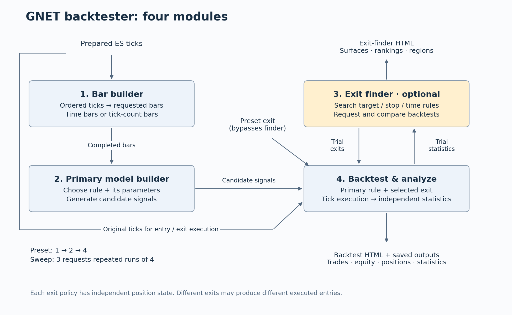

# GNET Backtester — user guide

Verified against the implementation on September 30, 2026.

This is the starting point for running an offline backtest. It explains the
four modules, what to configure, where data and results belong, and what is
actually available. It does not launch TradeStation, Docker, Redis, or liveye
trading. The backtester currently simulates one long ES contract per strategy
configuration.

## Start here: inventories, reports and commands

| What you need | Open this |
|---|---|
| Available strategies and their parameters | [Strategy inventory](../backtester_strategy_inventory.md) |
| Available assets, tick archives, dates, overlaps and adding data | [Data inventory](../backtester_data_inventory.md) |
| Exactly where to save files, filenames, schemas, merging and volume bars | [File and schema contract](../backtester_file_contract.md) |
| Group N imported tick bars or N imported volume bars | [Source-bar aggregation commands](../source_bar_aggregation.md) |
| Backtest statistics, exit-finder surfaces and numerical outputs | [Report directory with working example links](../backtester_reports.md) |
| Instructions for an agent running the system | [Agent runbook](BACKTESTER_AGENT_GUIDE.md) |
| Complete configuration and implementation details | [Technical reference](../backtester.md) |

From the repository root, these discovery commands read metadata only:

```powershell
.\.venv\Scripts\python.exe -m scripts.backtester_inventory strategies
.\.venv\Scripts\python.exe -m scripts.backtester_inventory data --asset ES
```

For machine-readable output, add `--json`. To inspect one archive, add
`--dataset es_spliced_20260921` to the data command. The catalog is in
[backtester.data_sources.json](../../config/backtester.data_sources.json); the
backtester still selects a source using `tick_root` in its experiment JSON.
The catalog command prints the resolved path to use.

Choose a fresh output directory in the configuration before running:

```powershell
# A fixed exit: backtest and statistics, without exit search.
.\.venv\Scripts\python.exe -m backtester.run --config config/backtester.preset.example.json
# A search: backtest statistics PLUS exit surfaces and combination rankings.
.\.venv\Scripts\python.exe -m backtester.run --config config/backtester.example.json
```

These are alternatives, not two required consecutive commands. The preset
example is a small two-session run; the sweep example covers a longer period.
Read section 4 before starting the larger job. Existing outputs require
`--resume` with an unchanged experiment or a new output path.

## 1. The four modules



| Module | What you give it | What it does | What you get |
|---|---|---|---|
| **1. Bar builder** | Ordered ES ticks and the bar types you request | Reconstructs only those bar series | Saved OHLCV bars with timestamps and source-event references |
| **2. Primary model builder** | Bars, a strategy name, and that strategy's parameters | Instantiates the selected entry rule and generates candidate signals | Saved candidate signals; these are not yet executed trades |
| **3. Exit finder — optional** | Stop, target and time-barrier ranges; search limits | Requests backtests for candidate exit combinations and explores their results | Exit-comparison HTML, surfaces, rankings and supported regions |
| **4. Analyzer of primary model + exit** | Candidate signals, one exit policy and the original ticks | Replays that strategy/exit combination with its own position state, then calculates statistics | Actual trades, skipped signals, equity/positions, statistics and a per-backtest HTML report |

“Primary model builder” currently means choosing and configuring a rule from
the strategy inventory. It is **not** an automatic strategy generator or an
NN trainer. MA lengths belong to the strategy, not to the bar builder or exit
finder.

Module 4 contains two code boundaries: the execution engine produces trades;
the independent results module analyzes them. Module 3 calls that execution
route repeatedly. Each exit combination has its own open position: a wide
exit can cause a later candidate to be skipped while a tighter exit takes it.
Workers evaluate different configurations over the full history, not isolated
date buckets with reset positions.

There are two ways to run:

- **Preset:** choose one complete exit policy yourself. Run modules 1, 2 and 4;
  bypass module 3. You still get the statistics report.
- **Sweep:** enable module 3 to search exit combinations. Each tested
  combination gets its own module-4 statistics report; module 3 additionally
  gets its own comparison/surface report.

The old independent-entry collector named `exit_module` is a different tool.
This guide is for `python -m backtester.run`, which respects position occupancy.

## 2. Correct checkout, worktree and Python

The implementation documented here is currently in:

```text
C:\Users\g_med\python_new\GNET
Branch: master
Python: C:\Users\g_med\python_new\GNET\.venv\Scripts\python.exe
```

The attached older research worktree is:

```text
C:\Users\g_med\.codex\worktrees\crossover-context\GNET
State: detached HEAD
```

That worktree does **not** currently contain `backtester/run.py`. Do not run
these commands there. A worktree is another checkout: uncommitted/untracked
files and ignored datasets/environments do not automatically appear in it.
These backtester sources are currently untracked in the main checkout, so
creating a worktree from the current commit would not include them yet.
No worktree or branch was created or moved by this documentation update.

If the implementation is moved to an isolated worktree later, first make sure
it actually contains the backtester and strategy sources. Use that checkout's
working directory, a verified compatible Python environment, an absolute
`tick_root` pointing to the existing archive, and a separate absolute `output`
directory. Do not assume its relative data paths or `.venv` exist. Never have
two coordinators write to the same output folder.

Read-only commands to identify your checkout:

```powershell
Set-Location 'C:\Users\g_med\python_new\GNET'
git rev-parse --show-toplevel
git branch --show-current
git worktree list
Test-Path .\backtester\run.py
Test-Path .\.venv\Scripts\python.exe
```

Use the explicit `.venv` Python commands below, even if the terminal prompt
says `(base)`. Do not install or run GNET in the base environment.

## 3. Where everything belongs

Paths below are relative to the main GNET directory unless shown as absolute.

| Item | Location | Your action |
|---|---|---|
| Prepared tick archive used by the examples | `historical_vp/prepared_spliced_2026_09_21/` | Treat as read-only input; do not overwrite it for a new experiment |
| Your experiment settings | `config/backtester.my_run.json` | Create a copy of an example and edit this file |
| Preset example | `config/backtester.preset.example.json` | Two-session, one-policy example |
| Sweep example | `config/backtester.example.json` | Broader June–September example; shorten dates before a smoke test |
| Strategy logic and its own parameters | `strategies/` | Currently `ma_cross.py`, registered in `registry.py` |
| Backtester modules | `backtester/` | No source edits needed to change dates, bars, exits or MA lengths |
| Generated results | `.artifacts/backtester/<unique-run-name>/` | Choose a new name for a changed experiment; generated files are Git-ignored |
| Detailed engineering reference | [documentation/backtester.md](../backtester.md) | Execution conventions and the full parameter reference |

The tick reader expects an **already prepared** archive, not a TradeStation
CSV dropped into `inputs`:

```text
your-tick-root/
  manifest.json                         optional timezone/vintage metadata
  parquet/
    session_date=2026-06-15/ticks.parquet
    session_date=2026-06-16/ticks.parquet
```

Each Parquet file needs `timestamp`, `price`, and `volume`. Preserve original
record order, including ties in timestamps. Naive timestamps use the configured
timezone. Prices must be valid ES tick prices and volume must be nonnegative
whole units. Use complete, consistently adjusted partitions: changing contract
price basis without identifying the boundary is not safe. The prepared archive's
manifest identifies old/new session vintages; the backtester resets strategy
state at that boundary and does not silently carry a position across it.

`tick_root` and `output` may be absolute paths. Relative paths are resolved
against the **JSON file's folder**, not the terminal's current directory.

## 4. Run your first backtest

### A. Check dependencies

```powershell
Set-Location 'C:\Users\g_med\python_new\GNET'
.\.venv\Scripts\python.exe -m backtester.run --help
```

If this environment is missing the offline dependencies, install them into
that environment only:

```powershell
.\.venv\Scripts\python.exe -m pip install -r backtester\requirements.txt
```

### B. Make your own configuration

Copy the preset example to `config/backtester.my_run.json` using your editor
or File Explorer. Do not overwrite an existing experiment configuration.

Before running, set these fields in your copy:

| Setting | Meaning | Example |
|---|---|---|
| `tick_root` | Prepared tick archive | `../historical_vp/prepared_spliced_2026_09_21` |
| `output` | New results folder | `../.artifacts/backtester/my_first_preset` |
| `start_session`, `end_session` | Inclusive session dates | `2026-06-15`, `2026-06-16` |
| `bars` | Series to construct | `[{"kind":"time","size":30}]` |
| `strategy.name` | Registered primary rule | `ma_cross` |
| `strategy.parameters` | Parameters owned by that rule | `{"fast":9,"slow":18,"reset_each_session":false}` |
| `execution_mode` | Whether to search exits | `preset` or `sweep` |
| `round_trip_cost` | Total charge per completed trade | `6.48`, deducted once, not per side |
| `slippage_ticks` | Adverse slippage per modeled market fill | `0` is an assumption, not a guarantee |
| `results.initial_capital` | Capital allocated to the experiment | Supply your chosen basis; `null` disables percentage-return/Sharpe calculations |

For preset mode, specify all three barriers:

```json
"execution_mode": "preset",
"preset_policy": {"profit_ticks": 4, "stop_ticks": 4, "hold_seconds": 120}
```

These are example numbers, not an optimized exit. `hold_seconds` is elapsed
wall-clock time after entry, not a bar count. Session flattening may close
the position earlier.

### C. Run and open results

```powershell
.\.venv\Scripts\python.exe -m backtester.run --config config\backtester.my_run.json
```

In your chosen output folder, open `backtesting_results.html`. Click a
configuration to see its statistics and downloads. The command also prints
the report location.

The output folder must be new. If the run was interrupted and you have not
changed its data, code or material settings, continue with:

```powershell
.\.venv\Scripts\python.exe -m backtester.run --config config\backtester.my_run.json --resume
```

### D. Optional: search exits instead

In a separate configuration and output folder, replace the preset settings
with the following. Remove `preset_policy`; it cannot accompany sweep mode.

```json
"execution_mode": "sweep",
"profits": [2, 4, 8],
"stops": [2, 4, 8],
"holds": [30, 120, 300],
"workers": 4,
"max_evaluations": 16,
"max_seconds": 120,
"patience": 2,
"jump_factor": 3,
"failed_jumps": 2
```

Run the same command with that configuration's filename. The finite lists
define the search domain. The finder uses neighborhood exploration and farther
probes, bounded by evaluation/time limits; it does not guarantee the global
best combination. An in-flight batch may finish after the time limit.

Open `reports/<bar-name>/index.html` for the **exit finder** report. Open
`backtesting_results.html` for the **individual backtests**. They are different
reports with different jobs.

### E. Preparation, report regeneration and reserved evaluation

```powershell
# Build tick caches, bars and candidate signals only.
.\.venv\Scripts\python.exe -m backtester.run --config config\backtester.my_run.json --prepare-only

# Continue a preparation-only run with the same configuration.
.\.venv\Scripts\python.exe -m backtester.run --config config\backtester.my_run.json --resume

# Rebuild reports from a completed run; does not replay ticks.
.\.venv\Scripts\python.exe -m backtester.run --config config\backtester.my_run.json --report-only
```

Those examples are alternative operations on the appropriate run state, not
a sequence to execute after a completed run without considering that state.
`--prepare-only` on an existing output needs `--resume` as well.

To reserve later sessions, set `confirmation_start` **before the initial run**,
strictly after the start session and no later than the end session. Development
uses earlier dates. Once you are done selecting, run:

```powershell
.\.venv\Scripts\python.exe -m backtester.run --config config\backtester.my_run.json --confirm
```

This freezes the selected policy per bar series, evaluates it on the reserved
period, and prevents further search in that run. It is not purged/embargoed
combinatorial CV, and previously inspected history does not become fresh data
because it is named “confirmation.”

## 5. Current inventory

### Module 1 — bar builder

| Available | Configuration | Meaning |
|---|---|---|
| Time bars | `{"kind":"time","size":30}` | 30 seconds; `900` means 15 minutes |
| Tick-count bars | `{"kind":"tick","size":1000}` | 1,000 trade records; `10` means 10 records |
| Volume bars | `{"kind":"volume","size":1000}` | At least 1,000 traded contracts; keep the whole final event |
| Imported-bar count aggregation | `python -m backtester.source_bars --source-kind tick/volume --source-size N --groups X ...` | Separate construction command: group X raw source bars; tick-execution alignment is not yet wired |
| Several requested series | Multiple objects in `bars` | Builds those series only; each gets its own strategy run |

Volume bars are implemented; **dollar bars, range bars and imbalance bars are
not implemented**. A tick-count bar counts records, not
traded contracts or price increments. Empty time intervals do not produce
invented bars; incomplete tail bars are excluded from signals.

Raw ticks carry volume, so the same archive supplies all three bar types.
Volume bars may exceed their threshold; trades are never split. See the
[file/schema contract](../backtester_file_contract.md) for details.

### Module 2 — primary model builder

Only **one production rule is registered today**:

| Rule | Trigger | Own parameters |
|---|---|---|
| `ma_cross` | On a completed bar, fast SMA crosses from at/below slow SMA to above it | `fast=9`, `slow=18`, `reset_each_session=false` |

The current interface proposes long entries only. The following eligible tick
is the modeled entry. The five-strategy inventory discussed earlier, native
strategy-specific exits, short entries and multi-position strategies are not
implemented yet. The existing live NN pipeline is separate; this backtester
does not automatically load or train its models.

For developers adding a rule: `strategies/base.py` defines the interface,
`strategies/registry.py` resolves names, and each implementation owns its
parameters. The backtester calls `on_session_start()` and `on_bar(bar)`;
`backtester/signals.py` maps the resulting candidates to ticks.

### Module 3 — exit finder

Implemented choices are a profit limit, a stop loss and a maximum holding
time, plus the session flatten/carry setting. Both preset and sweep modes
use the same execution engine. Price barriers are evaluated through the ticks,
not reconstructed from OHLC ordering.

The finder has finite axes, evaluation/time budgets, local patience, farther
jumps, several search seeds, validity/trade-count/drawdown constraints, and
positive-region summaries. It can display a least-bad eligible point even when
all tested outcomes lose; “selected” does not mean deployable.

Trailing stops, break-even moves, a learned per-entry exit selector and
strategy-native exit triggers are not supplied in this implementation.

### Module 4 — statistics inventory

The book's “efficiency” family includes Sharpe-related measures; it is not a
single additional score. The implementation is a subset, not a claim that all
of Chapter 14 has been reproduced. See the publisher's [chapter contents](https://catalogimages.wiley.com/images/db/pdf/9781119482086.toc.pdf).

| Statistic | Status | Exact current scope |
|---|---|---|
| Return concentration | Implemented | Normalized HHI for positive and negative net trade outcomes separately; also monthly exit-count concentration. Fewer than three contributions gives unavailable |
| Time-weighted rate of return | Conditional | Compounded observed-session returns using supplied initial capital; assumes no deposits/withdrawals and valid positive equity |
| Drawdown | Implemented | Exact tick-path maximum dollar drawdown from replay, plus sampled equity drawdown episodes |
| Time underwater | Implemented, sampled | Duration from an equity high until recovery, including unrecovered final episodes; may miss between-sample recovery |
| Sharpe ratio | Conditional | Per-session and annualized Sharpe from session returns, not per-trade outcomes |
| Probabilistic Sharpe ratio (PSR) | Conditional | Probability estimate relative to a zero-Sharpe benchmark; uses return moments and sample length |
| Deflated Sharpe ratio (DSR) | Conditional | Requires additional research-trial variance, effective independent trial count and provenance; not inferred from grid size |
| Other efficiency measures | Partial | Win rate, average win/loss, average trade and profit factor are present. No automatic minimum-track-record-length, information-ratio, Sortino or Calmar calculation |
| Buy-and-hold comparison | **Not implemented** | No benchmark curve, benchmark return or strategy-minus-benchmark metric yet |
| Activity / costs | Implemented | Trades, holding time, calendar exposure, closed-trade notional turnover, fees, modeled slippage and entry shortfall versus signal-bar close |
| Result distributions | Implemented | Net/gross P&L and win rate by exit reason, elapsed holding interval and exit month |
| ML classification, factor attribution, purged/embargoed CPCV | Not implemented here | Requires other inputs/procedures; reports do not claim to run them |

Sharpe/PSR require at least three finite, nonconstant session returns and valid
positive equity. That is a mathematical minimum, not enough data to claim
reliability. Missing archive sessions are not fabricated; serial correlation
is not corrected. Percentage returns and Sharpe statistics are unavailable
while `results.initial_capital` is `null`.

For DSR, `results.effective_trials`, `results.trial_sharpe_variance` and
`results.trial_history_note` must all be supplied. The variance uses
unannualized session Sharpe ratios from the relevant research history, including
unsuccessful trials; the note records its source and dependence assumptions.
Do not invent these inputs to make DSR appear. See the authors' [DSR paper](https://www.davidhbailey.com/dhbpapers/deflated-sharpe.pdf).

A future buy-and-hold benchmark needs an explicit rule for contract rolls,
entry/end dates, capital and costs. It must use the same comparison period
and price basis; simply subtracting the first spliced price from the last can
mistake an adjustment jump for investment return.

## 6. Read the output folders

```text
your-output/
  run.json                            effective settings and source/code identity
  prepared/
    bars_time_30.parquet               constructed bars
    signals_time_30.parquet            all primary candidates, not all trades
    times.npy, prices.npy, volumes.npy shared tick caches
    metadata.json                     sessions, counts and identity
  policies/<bar>/<phase>/<policy>/
    trades.parquet                    actual accepted entries/exits and outcomes
    skipped_signals.parquet            skipped candidates and reasons
    equity.parquet                    sampled equity and position state
    summary.json                      completed replay and search metrics
    statistics.json                   independent backtest statistics
    results.html                      that configuration's readable report
    session_returns.csv               session marks / returns
    drawdowns.csv                     sampled underwater episodes
  backtesting_results.html             catalog of all backtest reports
  search/<bar>.json                    sweep checkpoints only
  reports/<bar>/index.html             exit-comparison report, sweep only
  selections.json                     selected or explicitly preset policy
  confirmation_plan.json              created when confirmation starts
  confirmation.json                   reserved-period results, if run
```

`time_30` means 30-second bars; `tick_1000` means 1,000-record bars.
`development` and `confirmation` identify the data phase.
`pt4_sl4_h120` means a four-tick target, four-tick stop and 120-second time
barrier. All three define the policy; holding time is not 120 bars.

The current HTML reports show results and exit-search surfaces. A combined
candlestick chart with trade-entry/exit overlays is **not implemented yet**.
The bars and trades are saved independently so that viewer can be added.

## 7. Common problems and safe operation

| Message / symptom | What to do |
|---|---|
| `output already exists` | Use `--resume` for the same experiment, or choose a genuinely new output folder |
| `identity changed` | Code, material configuration or source inventory changed. Start a new output; do not edit the manifest to bypass the guard |
| `no tick sessions` | Check `tick_root`, partition layout and inclusive dates |
| Strategy or parameter rejected | Use the current inventory and keep MA lengths under `strategy.parameters` |
| Sharpe / return says unavailable | Check capital, session count, variance and trade validity; do not replace unavailable with zero |
| No search report | Expected in preset mode. Open `backtesting_results.html` |
| Candidate count exceeds trade count | Expected: candidates while occupied and other rejected signals are logged, not executed |
| Invalid or unresolved trades | Inspect coverage/gaps/exit delays before trusting rankings or returns |

Do not delete source ticks or previous reports to rerun a test. Use unique
outputs. A stopped process may finish its in-flight batch before shutting down.
No result is sent to a broker by this backtester.

## 8. Verification and engineering references

The last implementation check passed 45 focused tests. A two-session ES
regression used 1,560,519 ticks and retained identical trades, skip logs and
replay metrics for all 48 compared policies. These are engineering checks,
not proof of predictive power. The HTML content and local links were checked;
automated browser visual inspection was blocked.

```powershell
.\.venv\Scripts\python.exe -m pytest tests/test_backtester.py tests/test_backtester_results.py tests/test_exit_module.py
```

For code-level details see [the technical reference](../backtester.md)
and [module boundaries](../backtester_architecture.md). The current
workflow has four human-facing stages but keeps execution, statistics and
HTML rendering separate in code.
