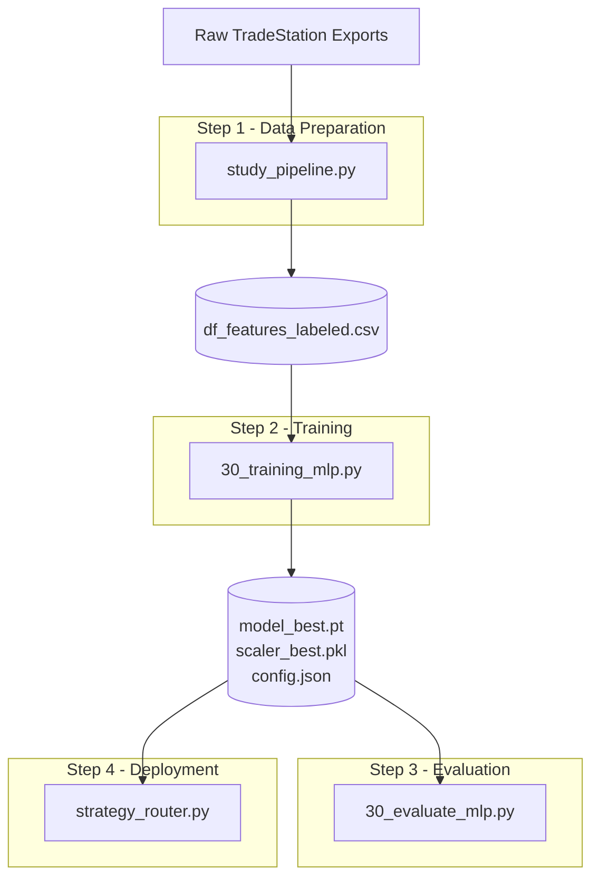

# How to Train the Meta-Labeling Model
> **What:** End-to-end guide for the offline ML pipeline — from raw TradeStation exports to trained model weights ready for live inference.

---

## Overview



---

## Step 1 — Export Raw Data from TradeStation

You need two files from TradeStation:

| File | What it is | Where to save |
|---|---|---|
| `trades_30.csv` | Trade log export — all MA2CrossLE entries with P&L | `training_mlp/strategies/MA2CrossLE/inputs/` |
| `data_30.txt` | Immutable legacy bars for reproducing the deployed MA2 model | `training_mlp/strategies/MA2CrossLE/inputs/` |
| `data_30_master.txt` | Current-adjustment research master updated going forward | `training_mlp/strategies/MA2CrossLE/inputs/` |
| `data_30_update_YYYY-MM-DD_to_YYYY-MM-DD.txt` | Incremental 30-second bar export | `training_mlp/strategies/MA2CrossLE/inputs/` |

**How to export the trade log:**
1. Open TradeStation → Strategy Performance Report
2. Export as CSV (includes Date/Time, Signal, % Profit columns)

**How to export bar data:**
1. Open the 30-second bar chart with the strategy applied
2. In the symbol/chart settings, select **For volume, use: Trade Vol**. This is
   mandatory: for electronic futures, TradeStation then defines `Up` and `Down`
   as contract volume rather than counts of price updates.
3. Export → Historical Data → CSV
4. Export exactly `Date, Time, Open, High, Low, Close, Up, Down`
5. Name an incremental export by its inclusive date range, for example
   `data_30_update_2026-05-20_to_2026-08-27.txt`

Offline feature engineering reconstructs TradeStation daily VWAP as cumulative
`AvgPrice × Volume / Volume`, where `AvgPrice = (Open + High + Low + Close) / 4`
and `Volume = Up + Down`. Live inference consumes the VWAP value sent directly
by TradeStation. Do not mix exports made with **Tick Count** into training.
This reconstruction has **not** been verified against a historical trade-level
VWAP series. In the VP45 walk-forward comparison,
the reconstructed-VWAP variant produced 8.42% less cost-adjusted net profit
than the prior-VWAP variant on the same candidates. Do not promote that research
model on the assumption that the reconstruction equals TradeStation's real-time
VWAP quote. TradeStation documents the EasyLanguage `VWAP` reserved word as a
**nonhistorical quote field**: historical Chart Analysis bars cannot recover
past values from it. Waiting until RTH does not change that limitation. The
next test requires a trustworthy historical per-bar VWAP series independently
derived from historical trades with the same session/reset rules, or another
verified historical source; the current `data_30_master.txt` does not include it.

Only if such a verified historical series becomes available, save a **separate** CSV at
`training_mlp/strategies/MA2CrossLE/inputs/vwap_30_tradestation_native.csv`.
Its header must be exactly `Date,Time,VWAP`, with dates like `03/15/2026`,
24-hour times like `18:00:30`, and one historically valid VWAP value per completed
bar. Cover the chart's full bar-master range, **March 15, 2026 18:00:30 through
August 27, 2026 05:13:30**, inclusive, using the same chart time zone, session,
symbol, and volume settings. Do **not** populate this file by replaying
TradeStation's `VWAP` quote word over old bars; that would repeat or misuse a
current snapshot. The builder rejects duplicate timestamps or any
missing master bar; it does not silently substitute reconstructed VWAP.
If one chart request is too large, export non-overlapping shorter ranges into
separate CSV files in one directory, then pass that directory with
`--native-vwap <directory>`. Each chunk must use the same three-column header.

After the export is present, run from the GNET root with the `training_mlp`
Conda environment (the runtime `.venv` does not include pandas):

```powershell
conda activate training_mlp
python -m training_mlp.build_native_vwap_dataset
```

This writes `df_features_labeled_master_libb_ts_native_vwap.csv` and a manifest
under the MA2CrossLE `processed` directory. It verifies the event set, labels,
and other 12 canonical features against the existing reference, replacing only
`vwap_distance`. It does **not** overwrite the bar master, prior feature files,
trained models, or live registry. Then use that isolated CSV as `--ma-input` to
`training_mlp.merge_ma_vp_features`, with a new output name for the 45-feature
native-VWAP comparison. Never point either step at the existing comparison
output filenames.

### Merge incremental 30-second exports safely

The two historical roles are intentionally separate:

```text
data_30.txt         = legacy 2025-based input that reproduces the deployed MA2 model
data_30_master.txt  = current-adjustment research master updated going forward
```

Never merge or overwrite the legacy file when extending the research dataset.

From the repository root, run:

```powershell
python -m training_mlp.merge_historical_bars
```

The module automatically discovers `data_30_master.txt` plus every
`data_30_update_*.txt`; when the master exists, it deliberately ignores the
legacy `data_30.txt`. It validates the eight-column contract and OHLC bounds,
sorts chronologically, removes identical timestamp/value overlaps, and aborts
if the same timestamp contains different values. It never overwrites a source.
Like the historical tick preparation module, it assigns every bar to the ES
session beginning at 18:00 and audits each session represented by more than one
source. The overlap report records per-source rows, shared timestamps, identical
matches, conflicting timestamps, and timestamps unique to each source.
Successful output is:

```text
training_mlp/strategies/MA2CrossLE/inputs/
├── data_30_master_merged.txt
├── data_30_master_merged.manifest.json
└── data_30_master_merged_overlap_sessions.csv
```

On a conflict, inspect both `data_30_master_merged_conflicts.csv` and the session
overlap report; no merged dataset is published. Point `BARS_FILE` to
the reviewed current master only after checking the manifest's sources, date range,
row count, removed-duplicate count, and overlapping-session diagnostics.

Continuous `@ES` exports produced at different rollover-adjustment dates may
shift every historical price and must not be combined. When one new export
already covers the complete intended research period, select it explicitly:

```powershell
python -m training_mlp.merge_historical_bars `
  --source .\training_mlp\strategies\MA2CrossLE\inputs\data_30_update_2026-03-15_to_2026-08-27.txt
```

Repeat `--source` only for additional exports created under a compatible
continuous-contract adjustment. Explicit selection preserves older source
files but excludes them from this generated dataset.

### Mandatory rollover handoff check

Whenever a new continuous-contract export is added, inspect the rollover
before building labels or features. Select the last ES session shared by the
old and new exports, then verify that the tick export and the 30-second-bar
export use the same price vintage. Compare the first and last bar OHLC, the
corresponding tick-derived OHLC, and the `Up`/`Down` totals at the handoff.
The first new tick and first new 30-second bar must start on the same price
scale. A large constant gap (such as 67.75 points) is a data-vintage change,
not market movement. Keep old ticks with old bars and new ticks with new bars,
record the cutoff session in a manifest, and never train across an unexamined
rollover or silently shift prices to hide the gap.

---

## Step 2 — Build the Labeled Dataset

### Current-adjustment master research dataset

Keep the deployed-model reproduction path below unchanged. To build the
separate research dataset from `data_30_master.txt` and
`trades_30_master.csv`, run from the repository root:

```powershell
python -m training_mlp.build_master_dataset
```

The builder discovers the `TradeStation Trades List` header rather than
assuming the legacy report's fixed row position, pairs every numbered entry
with its following exit, preserves the actual exit timestamp as `t1`, computes
the same 13 canonical features used live, and joins only exact entry/bar
timestamps. It refuses the legacy output name and writes only:

```text
training_mlp/strategies/MA2CrossLE/processed/
├── df_features_labeled_master.csv
└── df_features_labeled_master.manifest.json
```

To rebuild specifically from the corrected one-tick-LIBB execution report and
the TradeStation-VWAP feature contract, run:

```powershell
python -m training_mlp.build_master_dataset `
  --bars training_mlp\strategies\MA2CrossLE\inputs\data_30_master.txt `
  --trades training_mlp\strategies\MA2CrossLE\inputs\trades_30_libb_2026-04-07.csv `
  --output training_mlp\strategies\MA2CrossLE\processed\df_features_labeled_master_libb_ts_vwap.csv
```

The trainer accepts `FEATURES_FILE` as an environment override so this isolated
dataset can be trained directly without copying it over the legacy dataset.

The August 28, 2026 build matched 9,721 of 9,817 completed trades. The 96
unmatched trades occur after the current bar master ends at August 27, 2026
05:13:30 and can be recovered by adding the next compatible bar update.

To add the available canonical historical volume-profile features without
changing the 13-feature dataset or deployed model, run:

```powershell
python -m training_mlp.merge_ma_vp_features `
  --ma-input training_mlp\strategies\MA2CrossLE\processed\df_features_labeled_master.csv `
  --output training_mlp\strategies\MA2CrossLE\processed\df_features_labeled_master_vp.parquet
```

This produces a separate 45-feature research dataset and manifest. The first
master run matched 5,517 events to same-symbol, same-session, non-future VP
snapshots; all matched snapshots were exactly 1,000 ms before their entry.

### Compare feature contracts with purged walk-forward validation

Run the three research contracts on the same event universe and identical
past-only folds:

```powershell
python -m training_mlp.compare_purged_feature_sets
```

The runner fits a new `StandardScaler` and a fresh MLP inside every fold. It
does not save deployable model weights or modify the registry. Reports are
written to:

```text
training_mlp/strategies/MA2CrossLE/reports/pwf_feature_comparison/
├── fold_schedule.csv
├── fold_results.csv
├── summary.csv
├── validation_predictions.parquet
└── manifest.json
```

The original August 28 comparison used labels from the bar-resolution report.
Those results are retained for reproducibility but are superseded because that
report contained artificial next-bar-open stop/target fills.

The corrected August 30 comparison uses the one-tick-LIBB/prebuilt-stop report,
6,439 common MA+VP events, and five expanding folds. Mean validation ROC AUC is
0.5835 for MA-13, 0.6568 for full VP-45, and 0.6566 for reduced VP-42. VP still
provides a material improvement, while the two VP contracts remain effectively
tied. Corrected outputs are under `reports/pwf_feature_comparison_libb/`.

Calculate fixed-threshold out-of-sample trading statistics by joining every
validation prediction back to its exact TradeStation entry P&L:

```powershell
python -m training_mlp.analyze_pwf_trading
```

The default applies the configured approximate commission of $2.23 per side.
For the corrected LIBB export, pass `--commission-per-side 0` only when
reproducing the historical research report: TradeStation already deducted $2.25
on the entry and exit. For a current September 2026 low-volume ES estimate, pass
`--commission-per-side 0.99` instead. This adds only the missing amount per side
(`$3.24 - $2.25`) and brings the embedded $4.50 round trip to $6.48 without
double-counting it. On 5,365 common out-of-sample candidates at threshold 0.5,
MA-13 produced $14,486.50 net, profit factor 1.29, and $789.50 maximum drawdown;
VP-45 produced $28,552.00 net, profit factor 1.48, and $685.50 drawdown; VP-42
produced $27,824.50 net, profit factor 1.48, and the smallest drawdown at $572.
These are research comparisons, not deployable-model or live-return estimates.

The $2.23/$2.25 values above describe the historical research runs and must not
be treated as the current live cost assumption. As of September 2026, the
published low-volume TradeStation cost estimate for CME ES is $3.24 per side,
per contract ($6.48 round trip): $1.75 commission, $0.10 clearing, $1.38 CME
exchange fee, and $0.01 NFA fee. The actual account execution confirmation is
authoritative. New analyses must pass the verified all-in per-side amount
explicitly instead of silently reusing the historical default. Slippage remains
separate and is not included in the $6.48 estimate.

### CPCV hyperparameter search and chronological confirmation

Run the bounded randomized search over both VP feature contracts:

```powershell
python -m training_mlp.cpcv_hyperparameter_search
```

The runner searches hidden-layer depth/width, learning rate, weight decay,
dropout, batch size, and probability threshold. It uses CPCV(6,2), producing 15
purged/embargoed splits and five complete backtest paths per configuration. A
combined percentile score uses median path ROC AUC, average precision, profit
factor, average trade, and inverse p95 drawdown. The threshold must retain at
least a 10% median approval rate. Neither model weights nor registry entries are
written.

The August 30 corrected-label run evaluated 12 deterministic configurations per
contract at 30 epochs. VP-42 won with hidden layers `(96, 48)`, learning rate
`0.00046267`, weight decay `0.00019467`, dropout `0.46338`, batch size `32`, and
threshold `0.60`. Its five CPCV paths produced median ROC AUC 0.6571, profit
factor 1.90, net profit $23,279, and p95 maximum drawdown $671.30. The final
chronological 966-event confirmation segment produced ROC AUC 0.6631, profit
factor 1.97, $3,725.50 net profit, and $245 maximum drawdown.

The confirmation segment was exercised once by a two-epoch technical smoke test
before the full run. It was never used by the automated ranking, but it is not
strictly pristine. Treat these results as strong research evidence; confirm the
locked configuration once on the next future data export before deployment.
Reports are under `reports/cpcv_hyperparameter_search_libb/`.

### Audit TradeStation execution and backtest-resolution anomalies

#### IOG, IOG optimization, and Look-Inside-Bar are different settings

Do not treat these three mechanisms as interchangeable:

| Mechanism | Where it lives | Purpose | Main memory impact |
|---|---|---|---|
| `[IntrabarOrderGeneration = TRUE]` | EasyLanguage strategy code; TradeStation may pre-check its corresponding menu state | Recalculates the strategy within a live bar instead of only at bar close | Low by itself |
| `Enable Intra-bar Order Generation Optimization with Look-Inside-Bar` | Strategy Properties, Backtesting tab | Skips redundant same-price calculations when IOG and LIBB are already active | Reduces work; does not enable IOG or LIBB |
| `Use Look-Inside-Bar Back-testing: 1 Tick` | Strategy Properties, General tab | Supplies historical tick chronology inside each 30-second bar | Potentially enormous over long ranges |

The live GNET strategy intentionally contains:

```pascal
[IntrabarOrderGeneration = TRUE]
```

TradeStation can therefore show IOG as preselected in its menu. Keep this for
live operation: it allows decision polling and protective logic between
30-second closes. Disabling it does not solve the historical RAM problem;
loading months of one-tick Look-Inside-Bar data causes that problem.

For same-entry-bar protection, use TradeStation's built-in stop commands (or
the equivalent prebuilt Stop Loss and Profit Target strategies):

```pascal
SetStopContract;
SetStopLoss(50);
SetProfitTarget(50);
```

Built-in stops are specifically designed to become active on the entry bar.
Avoid implementing a one-handle protective exit only as:

```pascal
Sell next bar at EntryPrice - 1 stop;
```

That order may not exist during the entry bar. If the entry bar crosses the
intended stop or target and the historical engine waits for the following
30-second bar, the recorded fill can occur at the next bar open and create a
large artificial profit or loss. The MA audit found this exact signature in
1,469 of 1,475 outcomes beyond $70.

One-tick LIBB is still needed when both the one-point stop and target occur
inside the same 30-second bar, because OHLC alone cannot reveal which level was
reached first. Do not load the full multi-month range in one TradeStation chart;
use short date chunks or reconstruct exits from the historical tick Parquets,
then validate the reconstruction against a short one-tick LIBB sample.

Run the reusable report suite against any compatible TradeStation Trades List
and 30-second bar export:

```powershell
python -m training_mlp.audit_trade_anomalies `
  --trades training_mlp\strategies\MA2CrossLE\inputs\trades_30_master.csv `
  --bars training_mlp\strategies\MA2CrossLE\inputs\data_30_master.txt `
  --signal-name MA2CrossLE `
  --absolute-pnl-limit 70 `
  --expected-move-points 1 `
  --point-value 50 `
  --output training_mlp\strategies\MA2CrossLE\reports\trade_execution_anomalies.csv
```

The strict anomaly rule is `|trade P&L| > limit`. Alongside the flagged rows,
the command writes an enriched all-trades table, P&L distribution, exact
time-in-trade distribution, exit-signal summary, and JSON audit summary. It
also compares the intended stop/target level with the entry bar and records
whether TradeStation's exit price equals the exit bar open. Change the signal,
point value, expected move, threshold, input paths, and output filename to
reuse it for another strategy or instrument.

### Legacy deployed-model reproduction

```bash
cd training_mlp
python study_pipeline.py
```

This script:
1. Loads the bar data and parses OHLCV + Up/Down volume
2. Loads the trade log and applies **meta-labeling** — tags each MA2CrossLE entry as `1` (profitable) or `0` (loss)
3. Engineers all 13 microstructure features from the bars
4. Merges features + labels on timestamp
5. Exports `training_mlp/df_features_labeled.csv`

Expected output:
```
Loading bars...
Loading trades...
Engineering features...
Merging and exporting...
Saved → df_features_labeled.csv

Shape     : (17761, 15)
Label dist:
1    8984
0    8777
```

**INJECTIBLE parameters** at the top of `study_pipeline.py`:

| Parameter | Default | Description |
|---|---|---|
| `signal_name` | `"MA2CrossLE"` | Which strategy signal to meta-label |
| `OPEN_TIME` | `"09:30:00"` | Market open time for session features |
| `TRADES_FILE` | Desktop path | Path to TradeStation trade log CSV |
| `BARS_FILE` | Downloads path | Path to bar data CSV |
| `OUTPUT_FILE` | `"df_features_labeled.csv"` | Output path |

---

## Step 3 — Train the Model

```bash
cd training_mlp
python 30_training_mlp.py
```

This script:
1. Loads `df_features_labeled.csv`
2. Requires each label's entry timestamp and actual close timestamp (`t1`)
3. Reserves the chronological final 10% and purges training labels overlapping it
4. Runs event-aware purged expanding walk-forward cross-validation
5. Trains an MLP on each fold, saves per-fold weights and scalers
6. Selects the best fold by validation AUC
7. Saves `model_best.pt` and `scaler_best.pkl` under the configured strategy model directory

Expected output:
```
Device    : cpu
CV pool   : 15905 samples
Test      : 1776 samples — frozen until evaluate.py

Folds: 100%|████████| 5/5
  Fold 5  acc=0.5834 f1=0.5935 auc=0.6101

Best fold : 4  (val AUC 0.6386)
Default artifact directory: `training_mlp/strategies/MA2CrossLE/model/mlp_baseline`
```

> Requires a W&B account for experiment tracking. To skip W&B, comment out the `wandb.*` calls.

**INJECTIBLE parameters** at the top of `30_training_mlp.py`:

| Parameter | Default | Description |
|---|---|---|
| `DATA_FILE` | `"df_features_labeled.csv"` | Input dataset |
| `MODEL_DIR` | `"strategies/MA2CrossLE/model/mlp_baseline"` | Default artifact directory from `pipeline_paths.py` |
| `EPOCHS` | `100` | Max training epochs per fold |
| `BATCH_SIZE` | `64` | Mini-batch size |
| `LR` | `1e-3` | Peak learning rate |
| `PATIENCE` | `15` | Early stopping patience |
| `N_SPLITS` | `5` | Number of CV folds |
| `EMBARGO_PCT` | `0.01` | López de Prado observation-count embargo fraction |
| `TEST_SIZE` | `0.10` | Fraction held out as frozen test |

The MA splitter purges from actual `[Date/Time, t1]` label intervals. `t1` is
validation metadata and is never included in `FEATURE_COLS` or passed to the
MLP. The fixed `PURGE_BARS` and `EMBARGO_BARS` variables remain only for legacy
Zona trainers until those datasets are migrated.

---

## Step 4 — Evaluate on the Held-Out Test Set

```bash
cd training_mlp
python 30_evaluate_mlp.py
```

This script loads `model_best.pt` and `scaler_best.pkl`, runs them on the frozen `X_test.npy` / `y_test.npy`, and prints the final metrics. **Run this only once** — the test set is meaningless if you use it to make training decisions.

Expected output:
```
── Test results ─────────────────────────────────────
              precision  recall  f1-score  support
           0     0.5278  0.4146    0.4643      877
           1     0.5889  0.6938    0.6371      899

acc: 0.5822  f1: 0.6123  auc: 0.6203

Baseline acc : 0.5058
Test acc     : 0.5822  (↑ beats baseline)
```

Results are saved to the configured strategy model directory as `results_test.json`.

---

## Step 5 — Deploy for Live Inference

Once satisfied with the test results, the trained artifacts are ready to use in the live pipeline:

```bash
# From project root, after Redis and the feature service are running
python -m inference.strategy_router
```

`strategy_router.py` loads the mapped strategy's `model_best.pt`,
`scaler_best.pkl`, and `config.json` once at startup. It invokes them only for
matching trade candidates. See [[how_to_run_pipeline]] for live startup.

---

## Artifacts Produced

By default, all are saved to `training_mlp/strategies/MA2CrossLE/model/mlp_baseline/`:

| File | Description |
|---|---|
| `model_best.pt` | Production model weights (best fold by val AUC) |
| `scaler_best.pkl` | StandardScaler fitted on best fold's training data |
| `model_fold_{1-5}.pt` | Per-fold model weights |
| `scaler_fold_{1-5}.pkl` | Per-fold scalers |
| `X_test.npy` | Frozen test features (scaled by best scaler) |
| `y_test.npy` | Frozen test labels |
| `config.json` | All hyperparameters and dataset metadata |
| `results_cv.csv` | Per-fold CV metrics |
| `results_test.json` | Final held-out test metrics |

---

## Dependencies

```bash
pip install -r training_mlp/requirements.txt
```

Key packages: `torch`, `scikit-learn`, `pandas`, `numpy`, `wandb`, `tqdm`

## September 2026 data-source selection

For new research runs, use the paired session-boundary splice: old bars and
ticks through ES session 2026-08-14, then new bars and ticks from 2026-08-17.
The bar source is
`training_mlp/strategies/MA2CrossLE/inputs/data_30_spliced_2026-09-21.txt`
and the tick source is `historical_vp/prepared_spliced_2026_09_21/parquet`.
No price adjustment was applied. The manifests identify which source owns
each session. The earlier price-adjusted derived tick set is audit-only.

The old and new absolute price scales differ by 67.75 points. At the handoff,
the offline canonical feature builder resets its full 60-bar state at
2026-08-16 18:00:30 ET. The next 59 bars have no features; the 60th new bar
is the first eligible one. Build this separate, *unlabeled* feature artifact with:

```powershell
C:\Users\g_med\anaconda3\python.exe -m training_mlp.build_spliced_canonical_features
```

The output is `training_mlp/strategies/MA2CrossLE/processed/features_spliced_canonical_2026-09-21.parquet`
with a provenance manifest. The command above uses this machine's analysis
environment; on another installation, use the configured training interpreter.
Both splice-edge bars were checked against tick-derived OHLC and Up/Down totals.
**Do not train or switch the live model yet:** matching trade labels, VWAP/session
parity, and the final joined dataset still require validation.

The old and new LIBB Trades List exports can be staged without overwriting
either CSV:

```powershell
C:\Users\g_med\anaconda3\python.exe -m training_mlp.stage_spliced_trade_outcomes
```

This writes `processed/trade_outcomes_spliced_libb_2026-09-21.parquet` and a
manifest marked `training_ready: false`. It selects old-vintage trades through
the August 14 ES session and new-vintage trades from the August 17 session
through the last saved bar. It checks exact entry-bar timestamps, entry prices
against bar high/low, complete exits, and the post-splice feature warm-up.
Outcomes use gross TradeStation profit/loss less $3.24 per side for one ES
contract. The source CSVs remain unchanged.

**Candidate-timing check remains open:** TradeStation stamps time bars with
their closing time. Therefore, a Trades List entry sharing a timestamp with
a crossover bar does *not* by itself prove that the trade used unfinished-bar
information; a next-bar-open fill may share that clock time. The LIBB reports
do not contain a candidate decision timestamp, and the source strategy's
intrabar-order-generation settings need to be reconciled with live
`G_MA_CROSS_NN.els`, which sends candidates on completed bars. Do not declare
the staged outcomes trainable or leaky solely from timestamp equality. Verify
the mapping with a controlled TradeStation example or replay before joining
features to labels.
